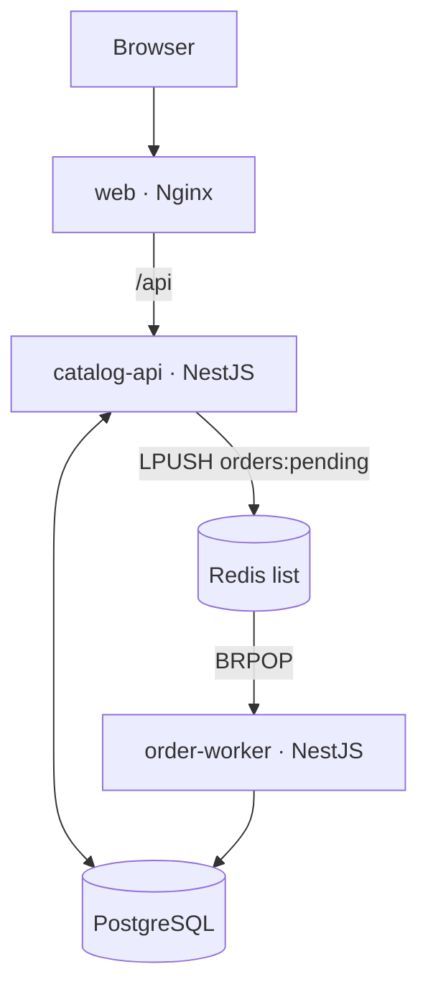

# ShopLite

A small shop split into three services: a static storefront, a REST API that
takes orders, and a background worker that completes them through a Redis
queue. Argo CD configuration lives in the separate `shoplite-gitops`
repository.

## How it works



1. **The shopper browses and orders.** The web app lists products and posts
   one order per cart line to `POST /api/orders`.
2. **The API accepts the order.** It saves the order as `PENDING`, pushes its
   id onto the `orders:pending` list and answers `201`.
3. **The worker completes it.** It pops the id, checks and takes the stock in
   one transaction, and sets the order to `COMPLETED` or `FAILED`.
4. **The shopper sees the result.** The order page polls
   `GET /api/orders/{id}` every 2 seconds until the status is final.

## Services

| Service        | Port | Endpoints                                                                 |
| -------------- | ---- | ------------------------------------------------------------------------- |
| `web`          | 8080 | the storefront; `/api/*` is proxied to `catalog-api`                      |
| `catalog-api`  | 3000 | `GET /products`, `GET /products/{id}`, `POST /orders`, `GET /orders/{id}` |
| `order-worker` | 3030 | no public API; it reads the queue                                         |

Both backend services also expose `/healthz` (process is up), `/readyz`
(database and Redis reachable) and `/metrics` (OpenMetrics, with exemplars on
the latency histograms). Logs are JSON lines with `timestamp`, `level`,
`service`, `message` and `trace_id`.

## Run locally

Requirements: Docker with Compose, GNU Make and Bash.

```bash
make up      # build the images and start the stack, waits until healthy
make smoke   # place an order through the web proxy and wait for COMPLETED
make down    # stop the stack; data stays in the named volumes
```

The shop opens on http://localhost:8080. On first start the `db-init` job
applies the migrations and loads 50 demo products.

## Tests

Requirements: Node 22 with Corepack enabled (it provides the pinned pnpm).

```bash
make test    # unit tests of every package and service
```

The integration tests use a real PostgreSQL and Redis. Start them, then run the
two suites one after the other, because both use the `shoplite_test` database:

```bash
docker compose up -d postgres redis
corepack pnpm --filter catalog-api test:integration
corepack pnpm --filter order-worker test:integration
```

## Chaos flags

All flags are off by default. Set them in the shell before `make up`.

| Flag                | Service        | Effect                                                 |
| ------------------- | -------------- | ------------------------------------------------------ |
| `CHAOS_LATENCY_MS`  | `catalog-api`  | delays 30% of `GET /products/{id}` by this many ms     |
| `CHAOS_ERROR_RATE`  | `catalog-api`  | fails this share of `POST /orders` with `500` (0 to 1) |
| `CHAOS_SLOW_DB`     | `order-worker` | waits 2 seconds before each database update            |
| `CHAOS_MEMORY_LEAK` | `order-worker` | keeps 256 KiB in memory for every processed order      |

## Deploy to Kubernetes

`helm/shoplite` deploys all five components into one namespace:

| Component      | Kind                                | Details                                                                         |
| -------------- | ----------------------------------- | ------------------------------------------------------------------------------- |
| `web`          | Deployment, 2 replicas              | Ingress path `/`                                                                |
| `catalog-api`  | Deployment, 2 replicas              | liveness `/healthz`, readiness `/readyz`, PDB `minAvailable: 1`, Ingress `/api` |
| `order-worker` | Deployment with an HPA from 1 to 4  | scales on CPU; a 30 s grace period lets the current order finish                |
| `postgres`     | StatefulSet with a PVC              | migrated and seeded by the `db-init` init container of `catalog-api`            |
| `redis`        | Deployment with a ClusterIP Service | holds the `orders:pending` queue                                                |

Every pod runs as a non-root user on a read-only root filesystem with requests and
limits set. NetworkPolicies deny all traffic by default and allow only what the app
needs; only `catalog-api` and `order-worker` reach PostgreSQL and Redis.

In the cluster, Argo CD installs it from
[shoplite-gitops](https://github.com/proatik/shoplite-gitops): dev on the ALB's port 8080 follows
every release automatically, and prod on port 80 changes when someone syncs it. CI never deploys; it
commits the new image tag to that repository.

The database password is a Secret created outside Git. To install by hand:

```bash
kubectl create namespace shoplite
kubectl -n shoplite create secret generic shoplite-db --from-literal=password="$(openssl rand -hex 16)"
helm install shoplite helm/shoplite -n shoplite \
  --set image.registry=<account>.dkr.ecr.<region>.amazonaws.com --set image.tag=<short-sha>
```

## Observability

The stack runs in the `monitoring` namespace; the chart connects to it when
`monitoring.enabled` is `true`.

| Signal     | Tool                                 | How ShopLite feeds it                                                     |
| ---------- | ------------------------------------ | ------------------------------------------------------------------------- |
| Metrics    | Prometheus (kube-prometheus-stack)   | ServiceMonitors scrape `/metrics` on `catalog-api` and `order-worker`     |
| Logs       | Loki, collected by Grafana Alloy     | Alloy reads every pod's JSON logs and keeps `level` and `trace_id`        |
| Traces     | Tempo, through the OpenTelemetry SDK | both services export OTLP; the queue message carries the trace context    |
| Dashboards | Grafana                              | `monitoring/dashboards/golden-signals.json`, provisioned from Git         |
| Alerts     | Alertmanager                         | `monitoring/alert-rules/shoplite.yaml`, each alert linking to its runbook |

The signals link to each other, so one order can be followed from an alert to the exact request:

1. A latency panel shows exemplar dots; each one opens the trace of that request in Tempo.
2. A trace runs API → `orders:pending` → worker → database, and opens the log lines that carry its id.
3. A log line's `trace_id` opens the trace it belongs to.

## AWS infrastructure

`terraform/` builds the VPC, the private k3s nodes, the public ALB, the ECR repositories and the
CI roles; see [terraform/README.md](terraform/README.md) for the steps and the security choices.

## Repository layout

```text
shoplite-app/
├── services/
│   ├── web/              React and Vite app, served as static files by Nginx
│   ├── catalog-api/      NestJS REST API, db-init script and seed data
│   └── order-worker/     NestJS queue consumer
├── packages/
│   ├── database/         Drizzle schema and SQL migrations
│   └── shared/           logger, tracing, metrics and the queue message format
├── helm/
│   └── shoplite/         one chart for the three services, PostgreSQL and Redis
├── terraform/
│   ├── modules/          network, compute, alb, ecr, plus bastion and backup_bucket
│   ├── envs/aws/         the AWS environment, CI roles, budget and Ansible inventory
│   └── state/            the S3 bucket that holds Terraform state
├── monitoring/
│   ├── dashboards/       the Golden Signals dashboard, loaded by Grafana's sidecar
│   ├── alert-rules/      the five alerts as a PrometheusRule
│   ├── runbooks/         one runbook per alert
│   └── values/           Helm values for kube-prometheus-stack, Loki, Tempo and Alloy
├── scripts/
│   └── smoke-test.sh     end-to-end check used by make smoke
├── docker-compose.yml    the full stack with health checks and hardening
└── Makefile              build, up, down, test and smoke targets
```

## Design notes

| Choice                                         | Why                                                                                                                                            |
| ---------------------------------------------- | ---------------------------------------------------------------------------------------------------------------------------------------------- |
| Images built `FROM scratch`                    | node, musl and the bundled app only: about 140 MB, no shell, run as uid 10001                                                                  |
| Prices stored in paisa, returned in taka       | integer money in the database; the API divides by 100 so the contract shows BDT                                                                |
| Cart and order list in `localStorage`          | the API has no accounts, so the browser keeps what this shopper placed                                                                         |
| Default database password in compose           | `make up` must work on a clean machine; set `POSTGRES_PASSWORD` to override it                                                                 |
| Ports bound to `127.0.0.1`                     | the local stack is not reachable from other machines                                                                                           |
| Tracing off in compose                         | no collector runs locally; unset `OTEL_SDK_DISABLED` and set `OTEL_EXPORTER_OTLP_ENDPOINT` to export                                           |
| Images built for x86-64                        | the runtime libraries are copied for one architecture, matching the lab and AWS hosts                                                          |
| Traefik as the ingress controller              | the brief allows ingress-nginx or Traefik; the community ingress-nginx controller stopped receiving fixes in March 2026, and k3s ships Traefik |
| `db-init` as an init container                 | it migrates and seeds under an advisory lock before `catalog-api` serves, so no Job has to be ordered or recreated on upgrades                 |
| Database Secret created outside Git            | the chart only references `shoplite-db`, so no password is ever committed                                                                      |
| Traces sent straight to Tempo                  | Tempo receives OTLP itself, so a separate collector would only add a hop to run and monitor                                                    |
| `trace_id` kept as structured metadata in Loki | it stays searchable and linkable without creating a log stream per trace                                                                       |
| Redis without a volume                         | the brief asks for a plain Deployment; append-only on an `emptyDir` survives container restarts, not pod replacement                           |
