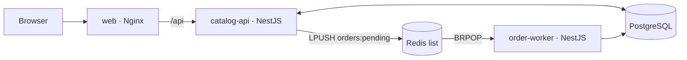

# ShopLite

A small shop split into three services: a static storefront, a REST API that
takes orders, and a background worker that completes them through a Redis
queue. Argo CD configuration lives in the separate `shoplite-gitops`
repository.

## How it works



1. **The shopper browses and orders.** The web app lists products and posts
   one order per cart line to `POST /api/orders`.
2. **The API accepts the order.** It saves the order as `PENDING`, pushes its
   id onto the `orders:pending` list and answers `201`.
3. **The worker completes it.** It pops the id, checks and takes the stock in
   one transaction, and sets the order to `COMPLETED` or `FAILED`.
4. **The shopper sees the result.** The order page polls
   `GET /api/orders/{id}` every 2 seconds until the status is final.

## Services

| Service        | Port | Endpoints                                                                 |
| -------------- | ---- | ------------------------------------------------------------------------- |
| `web`          | 8080 | the storefront; `/api/*` is proxied to `catalog-api`                      |
| `catalog-api`  | 3000 | `GET /products`, `GET /products/{id}`, `POST /orders`, `GET /orders/{id}` |
| `order-worker` | 3030 | no public API; it reads the queue                                         |

Both backend services also expose `/healthz` (process is up), `/readyz`
(database and Redis reachable) and `/metrics` (OpenMetrics, with exemplars on
the latency histograms). Logs are JSON lines with `timestamp`, `level`,
`service`, `message` and `trace_id`.

## Run locally

Requirements: Docker with Compose, GNU Make and Bash.

```bash
make up      # build the images and start the stack, waits until healthy
make smoke   # place an order through the web proxy and wait for COMPLETED
make down    # stop the stack; data stays in the named volumes
```

The shop opens on http://localhost:8080. On first start the `db-init` job
applies the migrations and loads 50 demo products.

## Tests

Requirements: Node 22 with Corepack enabled (it provides the pinned pnpm).

```bash
make test    # unit tests of every package and service
```

The integration tests use a real PostgreSQL and Redis. Start them, then run the
two suites one after the other, because both use the `shoplite_test` database:

```bash
docker compose up -d postgres redis
corepack pnpm --filter catalog-api test:integration
corepack pnpm --filter order-worker test:integration
```

## Chaos flags

All flags are off by default. Set them in the shell before `make up`.

| Flag                | Service        | Effect                                                 |
| ------------------- | -------------- | ------------------------------------------------------ |
| `CHAOS_LATENCY_MS`  | `catalog-api`  | delays 30% of `GET /products/{id}` by this many ms     |
| `CHAOS_ERROR_RATE`  | `catalog-api`  | fails this share of `POST /orders` with `500` (0 to 1) |
| `CHAOS_SLOW_DB`     | `order-worker` | waits 2 seconds before each database update            |
| `CHAOS_MEMORY_LEAK` | `order-worker` | keeps 256 KiB in memory for every processed order      |

## Repository layout

```text
shoplite-app/
├── services/
│   ├── web/              React and Vite app, served as static files by Nginx
│   ├── catalog-api/      NestJS REST API, db-init job and seed data
│   └── order-worker/     NestJS queue consumer
├── packages/
│   ├── database/         Drizzle schema and SQL migrations
│   └── shared/           logger, tracing, metrics and the queue message format
├── scripts/
│   └── smoke-test.sh     end-to-end check used by make smoke
├── docker-compose.yml    the full stack with health checks and hardening
└── Makefile              build, up, down, test and smoke targets
```

## Design notes

| Choice                                   | Why                                                                                                  |
| ---------------------------------------- | ---------------------------------------------------------------------------------------------------- |
| Images built `FROM scratch`              | node, musl and the bundled app only: about 140 MB, no shell, run as uid 10001                        |
| Prices stored in paisa, returned in taka | integer money in the database; the API divides by 100 so the contract shows BDT                      |
| Cart and order list in `localStorage`    | the API has no accounts, so the browser keeps what this shopper placed                               |
| Default database password in compose     | `make up` must work on a clean machine; set `POSTGRES_PASSWORD` to override it                       |
| Ports bound to `127.0.0.1`               | the local stack is not reachable from other machines                                                 |
| Tracing off in compose                   | no collector runs locally; unset `OTEL_SDK_DISABLED` and set `OTEL_EXPORTER_OTLP_ENDPOINT` to export |
| Images built for x86-64                  | the runtime libraries are copied for one architecture, matching the lab and AWS hosts                |
