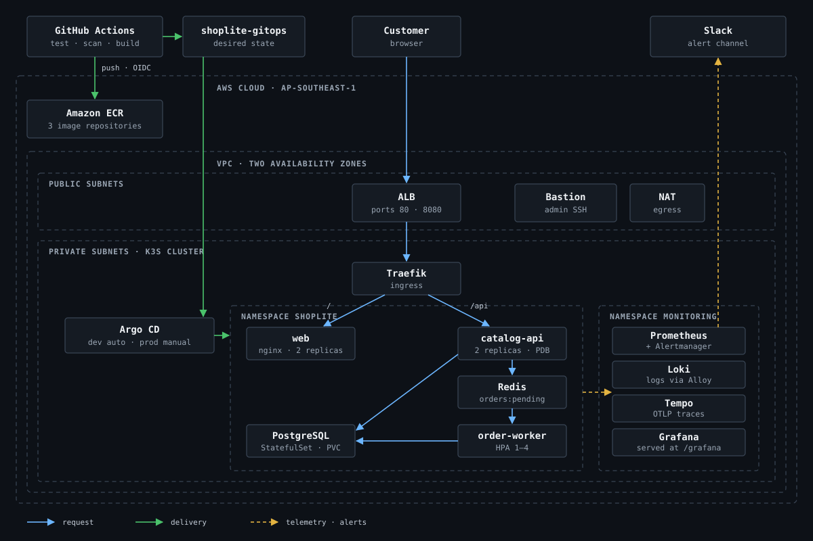

# Architecture

| Colour         | Path                                                                                 |
| -------------- | ------------------------------------------------------------------------------------ |
| Blue           | A request: browser → ALB → Traefik → `web` or `catalog-api` → Redis → `order-worker` |
| Green          | A change: GitHub Actions → ECR and `shoplite-gitops` → Argo CD → the cluster         |
| Amber (dashed) | Telemetry: the services → Prometheus, Loki and Tempo → Grafana; Alertmanager → Slack |

## Layout

| Layer      | What runs there                                                                     |
| ---------- | ----------------------------------------------------------------------------------- |
| AWS region | ECR (three image repositories) and the VPC                                          |
| VPC        | Two Availability Zones, each with one public and one private subnet                 |
| Public     | The ALB (prod on port 80, dev on 8080), the bastion and the NAT gateway             |
| Private    | The k3s cluster: one control plane and two workers, none with a public IP           |
| Cluster    | Traefik, Argo CD, the `shoplite` namespace (the app) and the `monitoring` namespace |

## Trade-offs

- **Bastion, not SSM.** The lab account's organisation policy blocks Session Manager, so admin access
  uses a bastion that only the admin address can reach. `admin_access=ssm` remains the default.
- **One NAT gateway.** Both private subnets route through the NAT in the first zone, which keeps the
  lab cost down; losing that zone stops outbound traffic until it returns.
- **k3s, not kubeadm.** k3s ships containerd as the container runtime and needs one binary per node.
