# Linux evidence

Terminal screenshots from the lab nodes for Question 3: users and SSH, permissions, backup and firewall.

### Session on the control plane

Ubuntu 24.04 node reached through the bastion.

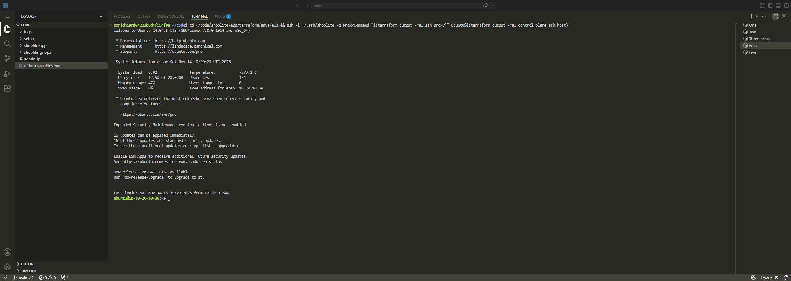

### Session on the bastion

The only host with a public address.

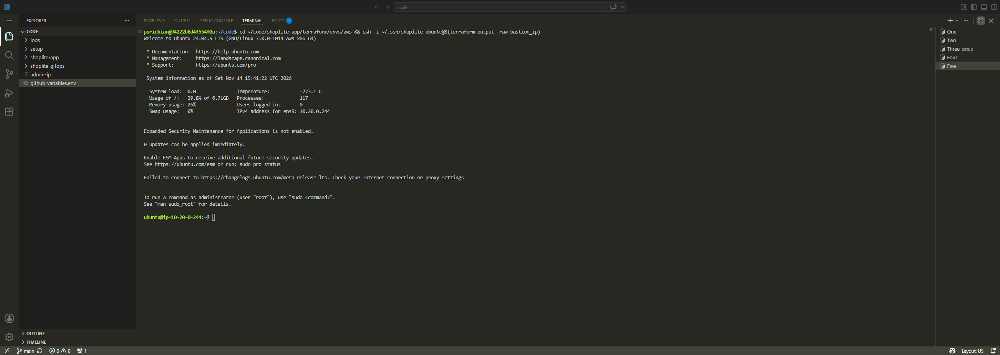

### 3.1 User and group

deploy is in ops.

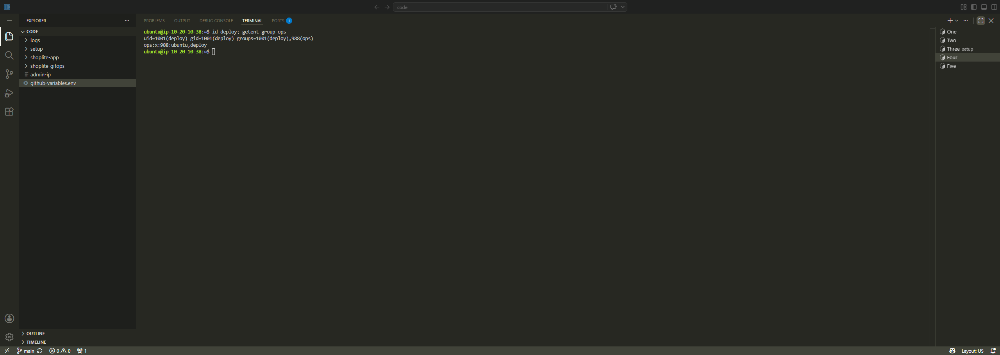

### 3.1 Root login refused

The server rejects root over SSH.

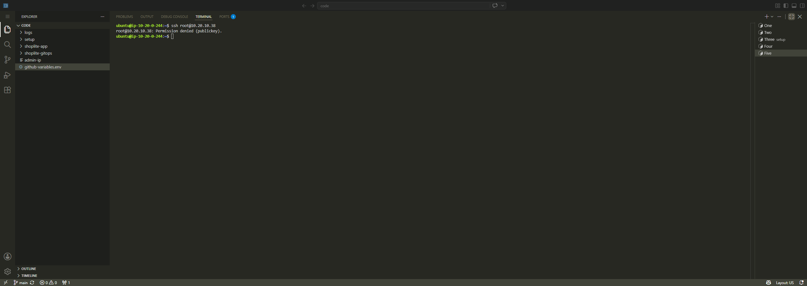

### First connection to the node

The bastion confirms the node's host key once.

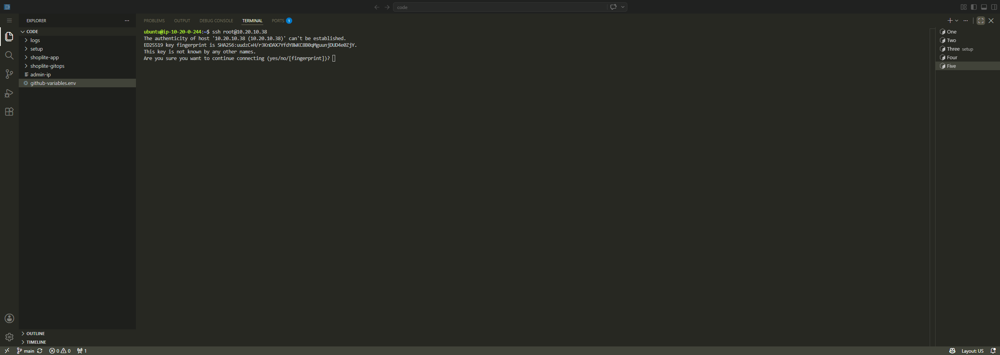

### Root refused, server side

sshd logs root as not allowed by AllowGroups.

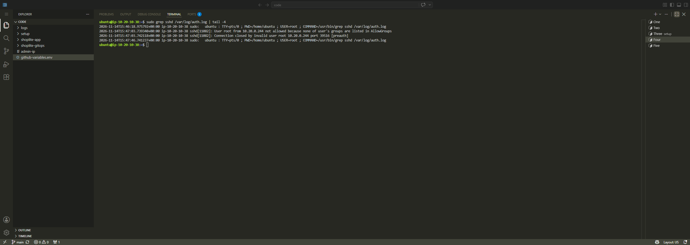

### First attempt timed out

LoginGraceTime 30 closed the connection while the host-key prompt waited.

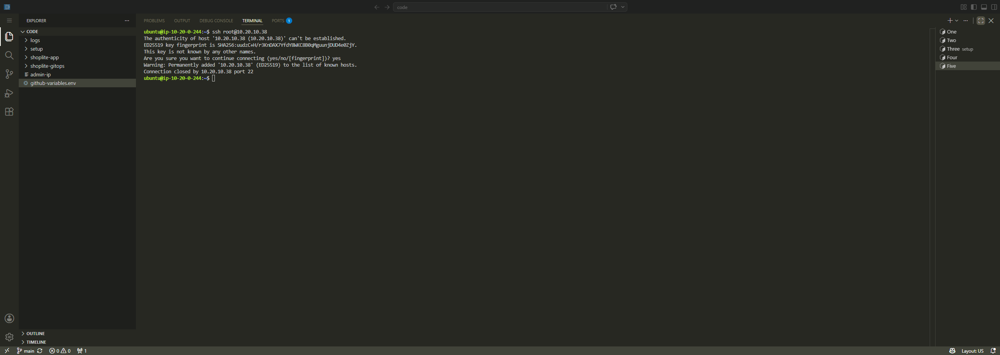

### 3.1 Password login refused

Without a key, the login is refused.

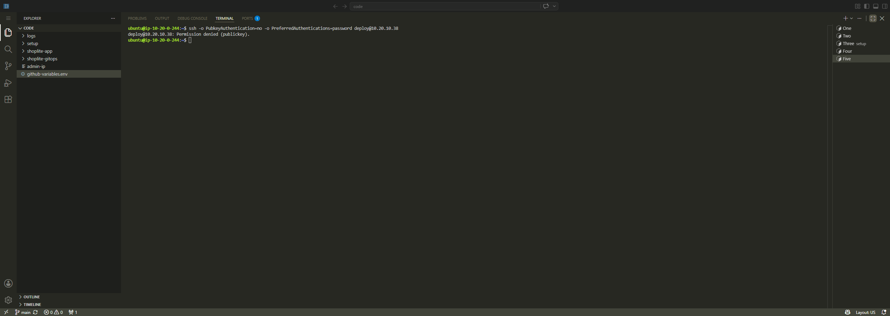

### 3.2 Log directory permissions

Owner, mode and the single ACL rule.

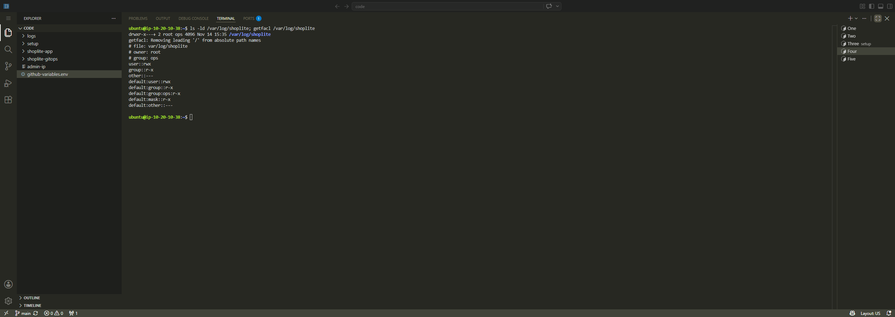

### 3.3 Backup service

The last run finished successfully.

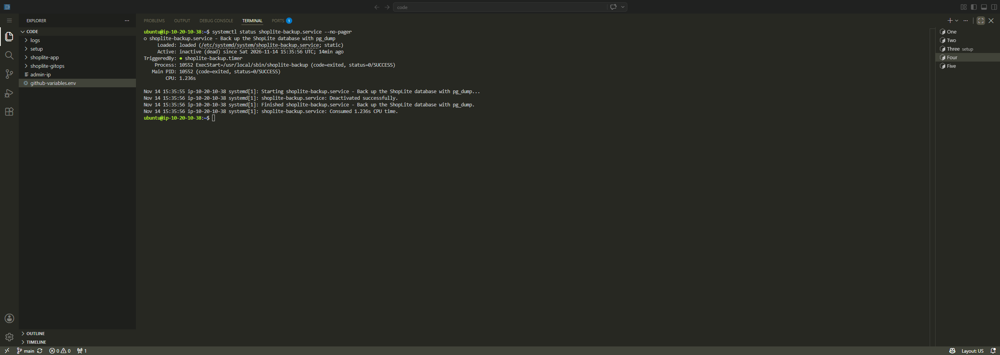

### Backup unit file

Restart=on-failure, its own user and a hardened sandbox.

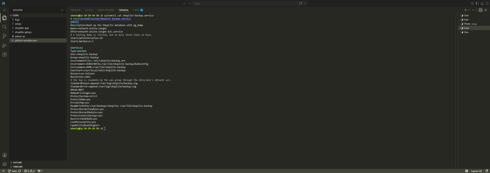

### 3.3 Nightly timer

The next run is scheduled for 02:00.

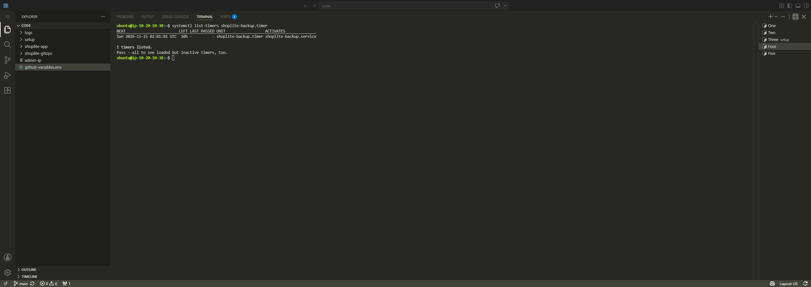

### 3.3 Backup files

Dumps in /var/backups/shoplite/ and in S3.

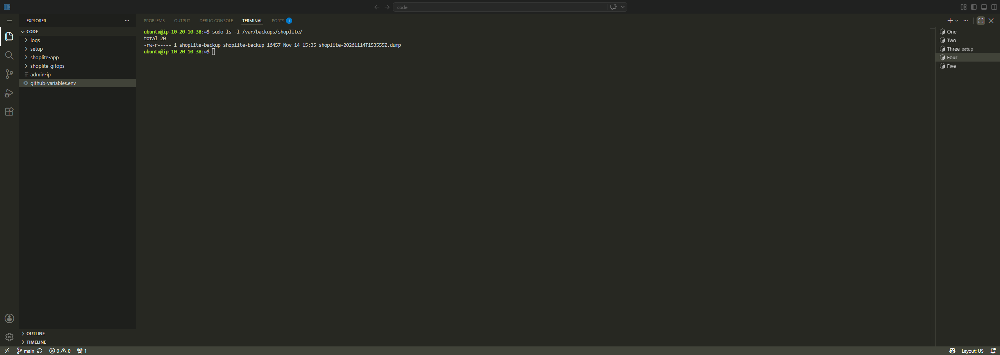

### Backup copied to S3

The same dump in the backup bucket.

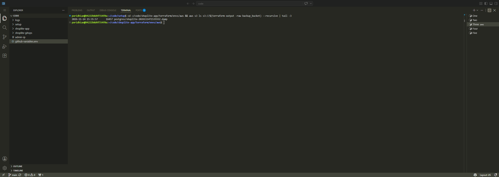

### 3.4 Firewall rules

Default deny; 22, 80, 443 allowed.

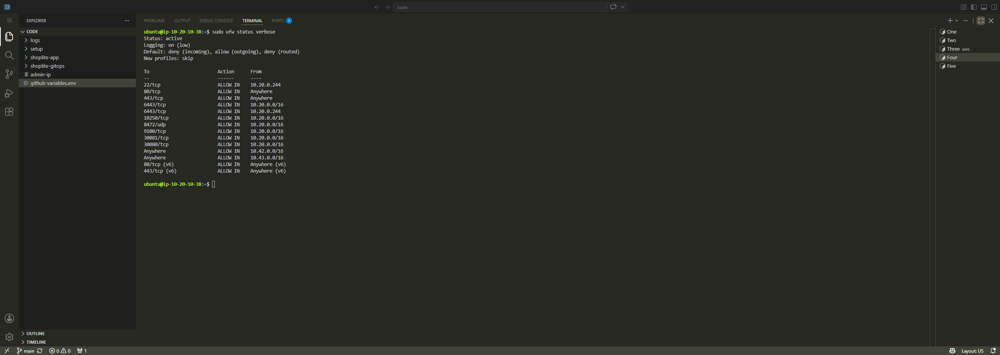

### 3.4 Listening ports

Only the expected services are listening.

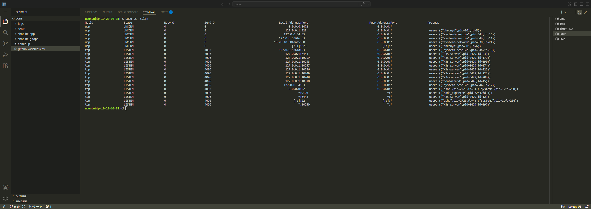

### 3.4 Open and blocked port from another machine

Port 22 answers; a closed port times out.

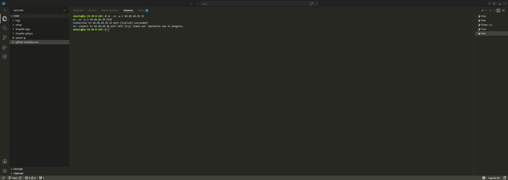
